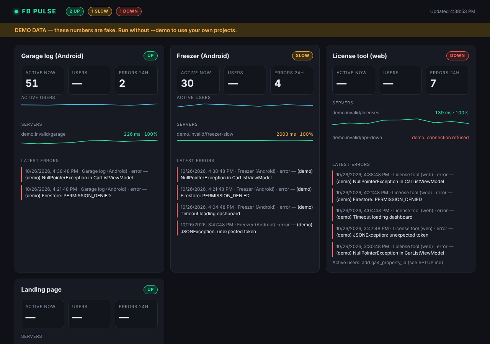

# FB Pulse

A small, **free**, local dashboard for the health of your Firebase projects: are the servers up, how many users
are active right now, how many are registered, and what errors your apps reported in the last 24 hours.



> The screenshot uses fake data (`python main.py --demo`).

- Runs on your own computer (`127.0.0.1`). No hosting, no account, nothing uploaded.
- Works with the Firebase **Spark** (free) plan. Reads of your Firebase data are tiny and every panel is optional.
- Your keys stay in the `keys/` folder, which git ignores. **Read [SETUP.md](SETUP.md) for exactly where to put them.**

## Quick start

```bash
python -m pip install -r requirements.txt
python main.py --demo          # try it with fake data
cp config.example.json config.json   # then edit it and follow SETUP.md
python main.py
```

## Honest limits

- Crashlytics crash reports cannot be read for free by a custom dashboard (only through BigQuery, which can cost
  money). FB Pulse uses a small error log that your apps write to Firestore instead (SETUP.md, step 5).
- Active users come from the GA4 realtime API and can differ a little from the number in the Firebase console.
- Written and tested against simulated data only; the Firebase calls have not been run against a real project yet.
  If a panel shows an error, it shows the exact message so you can fix the setup.

## Tests

```bash
python -m unittest discover -s tests -v
```
